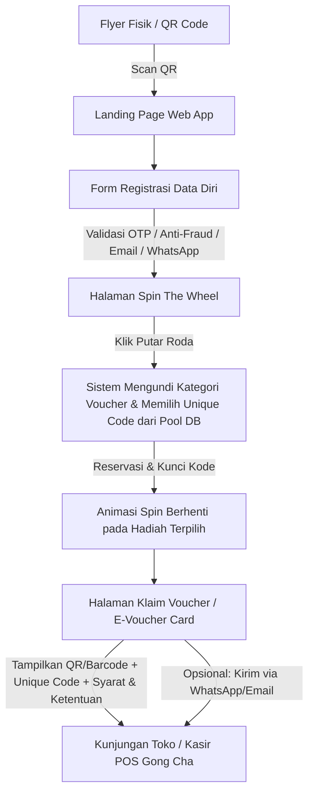
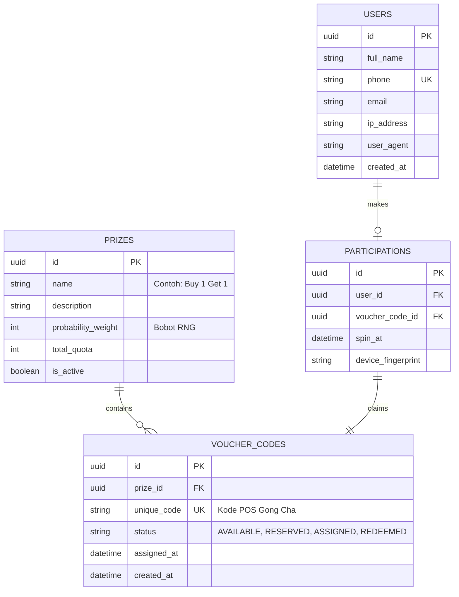

# Gong Cha Grand Opening: Pre-Opening Activation Web App (Spin The Wheel)
**Product Requirements Document (PRD) & Technical Architecture**

---

## 1. Ringkasan Proyek (Overview)
Aktivasi Pre-Opening Grand Opening Gong Cha berupa kampanye interaktif berbasis Web App (Mobile-first). Pengunjung memindai QR Code dari flyer fisik, mengisi data diri (lead capture), memutar roda keberuntungan (*Spin The Wheel*), dan memperoleh kode voucher unik/eksklusif secara acak yang langsung terhubung dan dapat divalidasi pada sistem POS (*Point of Sale*) Gong Cha saat Grand Opening.

---

## 2. Alur Pengguna (User Journey / Flow)

### Detail Tahapan:
1. **Scan QR Code:** Pengunjung scan QR code di flyer yang membawa pengunjung ke URL landing page (misal: `https://promo.gongcha.co.id/grand-opening`).
2. **Lead Capture (Registrasi):** 
   - Input: Nama Lengkap, Nomor WhatsApp / Handphone, Email, Tanggal Lahir (opsional untuk profiling member).
   - *Security Check*: Batasan 1 Nomor HP/Email hanya boleh berpartisipasi 1 kali (*one-time participation*).
3. **Spin The Wheel:**
   - Setelah data tersimpan, pengguna diarahkan ke antarmuka interactive wheel.
   - User menekan tombol "Putar / Spin".
   - *Backend-driven RNG*: Penentuan hadiah dan alokasi kode unik voucher dilakukan di backend (bukan clientside) untuk mencegah manipulasi.
4. **Voucher Reveal & Claim:**
   - Menampilkan voucher card yang memuat:
     - Nama Voucher / Benefit (Contoh: *"Free Pearl Milk Tea", "Diskon 50%", "Buy 1 Get 1"*).
     - **Unique Voucher Code** (misal: `GC-GO-98X2K1`).
     - Barcode / QR Code untuk discan oleh scanner kasir POS.
     - Masa berlaku & Syarat Ketentuan (T&C).
     - Tombol *Download Image / Screenshot* atau kirim otomatis salinan voucher via WhatsApp/Email.

---

## 3. Sistem Pengelolaan Voucher & Integrasi POS

### 3.1 Pre-seeded Voucher Pool (Master Data Input)
Sebelum aplikasi dibuka untuk publik:
1. Tim POS/Operasional Gong Cha mengekspor daftar kode promo unik dari sistem POS dalam format CSV/Excel.
2. Admin mengunggah/mengimpor kode-kode tersebut ke database web app melalui script CLI atau Admin Dashboard.
3. Struktur voucher diatur berdasarkan tier/kategori hadiah beserta probabilitas/bobot kelipatan spin.

### 3.2 Status Siklus Voucher
- `AVAILABLE`: Kode siap diberikan kepada peserta.
- `RESERVED`: Kode sedang dialokasikan saat animasi spin berjalan (TTL 5-10 menit).
- `CLAIMED / ASSIGNED`: Kode sudah resmi dimiliki oleh user tertentu.
- `REDEEMED`: Kode telah dipakai di kasir POS (sinkronisasi status POS jika API realtime tersedia).

---

## 4. Skema Database (Database Schema Recommendation)

---

## 5. Kebutuhan Non-Fungsional & Keamanan (Anti-Fraud)

1. **Anti-Fraud & Duplicate Prevention:**
   - Unique constraints pada Nomor HP & Email di database.
   - Device Fingerprinting & IP Rate Limiting untuk mencegah automated bot/script submission.
   - RNG dihitung di server (Backend), bukan ditentukan oleh animasi browser.
2. **Concurrency & Race Condition Handling:**
   - Memastikan tidak ada 2 user yang mendapatkan kode voucher POS yang sama (`SELECT ... FOR UPDATE SKIP LOCKED` atau atomic reservation).
3. **Mobile-First Responsiveness:**
   - Didesain khusus untuk tampilan smartphone (iOS Safari & Android Chrome/WebView).
   - Audio feedback saat roda berputar dan efek selebrasi konfeti saat menang.
4. **Performance & Scalability:**
   - Siap menerima lonjakan trafik serentak (traffic spike) saat flyer disebar di area sekitar outlet.

---

## 6. Checklist Roadmap Implementasi

- [ ] **Fase 1: Persiapan & Format Data POS**
  - Menentukan daftar hadiah, kuota masing-masing, dan template format kode POS.
  - Penyiapan file CSV/Excel kode voucher unik.
- [ ] **Fase 2: Setup Database & Backend Service**
  - Schema migration & API endpoints (registrasi, claim/spin, voucher query).
  - Skrip batch import CSV kode voucher ke database.
- [ ] **Fase 3: Frontend Web App**
  - Landing page flyer promo & Form leads.
  - Komponen kanvas/SVG interaktif *Spin The Wheel*.
  - Halaman E-Voucher Card dengan barcode/QR render.
- [ ] **Fase 4: Testing & Uji Coba POS**
  - Import sampel 50-100 kode test.
  - Simulasi scan kasir POS Gong Cha langsung di mesin kasir fisik.
  - Load test simulasi kunjungan massal.
- [ ] **Fase 5: Peluncuran (Go-Live)**
  - Import seluruh kode voucher POS resmi.
  - Cetak QR code final pada flyer grand opening.
